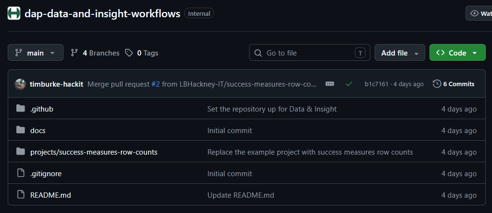

# Team workflow repositories

A team workflow repository holds a team's data projects. Each project becomes a
DAG (a scheduled pipeline) in the Data Analytics Platform's Airflow. The team
writes and changes its projects in its own GitHub repository and decides when
they go to production. Routine changes don't need a pull request to a platform
repository.

The repository is named `dap-<team>-workflows`, where `<team>` is the team's
platform department, for example `dap-data-and-insight-workflows`.

## What a project can do

A project is a folder in `projects/`. It can have two kinds of task:

- **Table tasks** run a SQL query in Athena and save the result as a table. A
  project with only table tasks needs only a `project.yaml` file and a `sql/`
  folder.
- **Python tasks** run your Python code on ECS. Use them for work that SQL can't
  do, such as calling an API or reading files.

[Project reference](project-reference) describes both.

## How a change reaches production

1. You open a pull request. The **Check** workflow tests it.
2. Someone in your team reviews it and merges it into `main`.
3. The **Deploy** workflow puts every project into pre-production.
4. You run the DAG in pre-production and check the result.
5. You run the **Promote** workflow for the project. A team lead or the platform
   team approves it, and the project goes to production.

Nothing deploys from a pull request or any other branch, only from `main`.
Production keeps running the old version of a project until someone promotes
the new one, and promoting one project leaves the others as they are.

## Who does what

| Who | What they do |
| --- | --- |
| Analysts in the team | Change projects, open pull requests, test in pre-production, start promotions |
| Project leads / Platform Team | Review pull requests, approve production releases |
| Platform team | Set up the repository and each new project once, approve changes to `.github/` |

## Names you'll see

| Name | Meaning |
| --- | --- |
| `<team>__<project>` | The DAG in Airflow. Hyphens become underscores, so `success-measures-row-counts` in `data-and-insight` is `data_and_insight__success_measures_row_counts`. |
| `team_project` | The tag on every team project DAG in Airflow. Each DAG also has the team as a tag. |
| `prod__<database>` | In pre-production, a link to a production database. Tests read from these. |
| `test__<database>` | In pre-production, a database that your projects write to. Tests write to these. |

## Guides

1. [Make a change](make-a-change)
2. [Test in pre-production](test-in-pre-production)
3. [Release to production](release-to-production)
4. [Project reference](project-reference)
5. [When something fails](troubleshooting)
6. [Add a project](adding-a-project)

The template repository,
[dap-team-workflows-template](https://github.com/LBHackney-IT/dap-team-workflows-template),
has an example project with one Python task and one table task.
