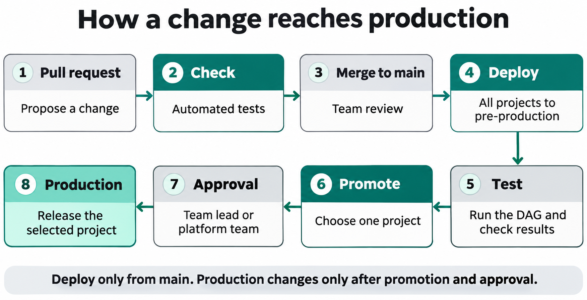

# Team workflow repositories

A team workflow repository holds a team's data projects. Each project becomes a
DAG (a scheduled pipeline) in the Data Analytics Platform's Airflow. Your team
writes and changes its projects in its own GitHub repository and decides when
they go to production. Routine changes don't need a pull request to a platform
repository.

The repository is named `dap-<team>-workflows`, where `<team>` is the team's
platform department, for example `dap-data-and-insight-workflows`.

## Before you start

You need:

- **Your team's GitHub repository** (`https://github.com/LBHackney-IT/dap-<team>-workflows`). If your team doesn't have one yet, ask the Data Analytics Platform team via Halo to set it up.
- **A GitHub account** in the `LBHackney-IT` organisation with write access to your team's repository. Ask your team lead or the platform team if you can't open the repository or edit files.
- **Access to pre-production and production AWS** so you can open Airflow and Athena in both environments.

If your project only runs SQL queries, you don't need to install Git, Python or
Docker on your computer. You can do everything in the GitHub website.

## What a project can do

A project is a folder in `projects/`. It can have two kinds of task:

- **Table tasks** run a SQL query in Athena and save the result as a table. A
  project with only table tasks needs only a `project.yaml` file and a `sql/`
  folder.
- **Python tasks** run your Python code on ECS. Use them for work that SQL can't
  do, such as calling an API or reading files.

[Project reference](project-reference) describes both.

## How a change reaches production

1. You make your changes on a **branch** and open a **pull request** (a request
   to add your changes to the repository). The **Check** workflow tests them
   automatically.
2. Someone in your team reviews the pull request and merges it into `main` (the
   live version of the repository).
3. The **Deploy** workflow puts every project into pre-production.
4. You run the DAG in pre-production Airflow and check the result in
   pre-production Athena.
5. You run the **Promote** workflow for the project. A team lead or the platform
   team approves it, and the project goes to production.

Nothing deploys from a pull request or any other branch, only from `main`.
Production keeps running the old version of a project until someone promotes
the new one, and promoting one project leaves the others as they are.

## Who does what

| Who | What they do |
| --- | --- |
| Analysts in the team | Add and change projects, open pull requests, test in pre-production, start promotions |
| Project leads / Platform team | Review pull requests, approve production releases |
| Platform team | Set up the repository and each new project once, approve changes to `.github/` |

## Names you'll see

| Name | Meaning |
| --- | --- |
| `main` | The default branch in GitHub. Merging into `main` deploys to pre-production. |
| **Branch** and **pull request** | A branch is a separate copy where you make edits without changing `main`. A pull request proposes merging your branch into `main` once checks and a review pass. |
| `staging` | What GitHub Actions calls **pre-production** (for example the **Deploy to staging** job). They mean the same environment. |
| `<team>__<project>` | The DAG in Airflow. Hyphens become underscores, so `success-measures-row-counts` in `data-and-insight` is `data_and_insight__success_measures_row_counts`. |
| `team_project` | The tag on every team project DAG in Airflow. Each DAG also has the team as a tag. |
| `prod__<database>` | In pre-production, a read-only link to a production database. Tests read from these. |
| `test__<database>` | In pre-production, a database that your projects write to. Tests write to these. |

## Guides

1. [Add a project](add-a-project) — schedule a new project from scratch
2. [Make a change](make-a-change) — edit an existing project and open a pull request
3. [Test in pre-production](test-in-pre-production) — run the DAG and check its tables
4. [Release to production](release-to-production) — promote a tested project to production
5. [Project reference](project-reference) — `project.yaml`, schedules, table tasks and Python tasks
6. [When something fails](troubleshooting) — reading errors and rerunning tasks
7. [Platform team setup](platform-team-setup) — how the platform team sets up repositories and projects

The template repository,
[dap-team-workflows-template](https://github.com/LBHackney-IT/dap-team-workflows-template),
has an example project with one Python task and one table task.
