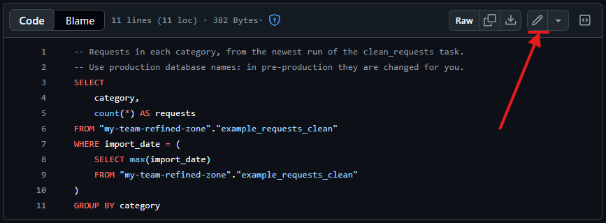
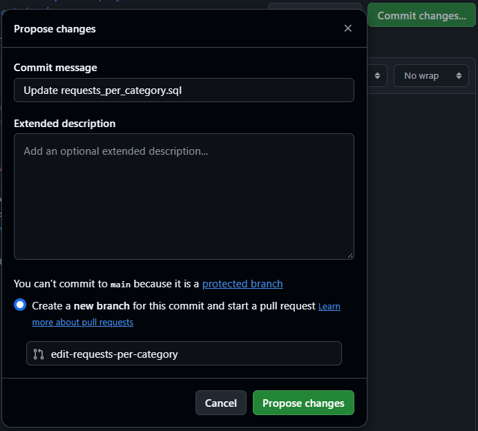
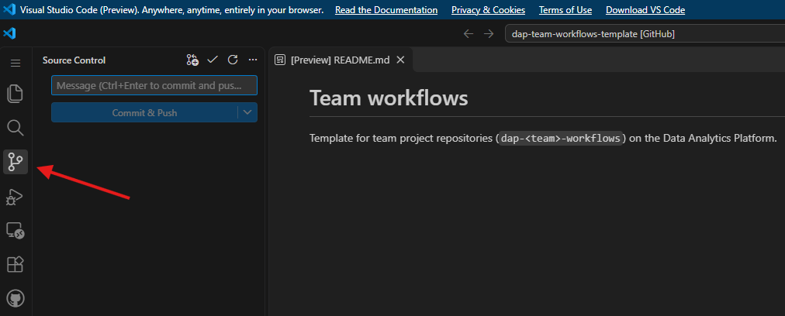
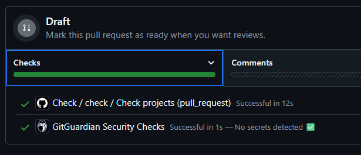
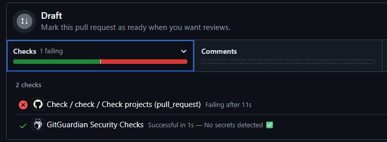

# Make a change

You can make a change in the GitHub website or on your own computer. Every
change goes through a pull request.

If you're new to GitHub, read [Using GitHub](../getting-set-up/using-github)
first.

## In the GitHub website

Use the website for small changes to `project.yaml` or a SQL file.

1. Open the file and select the pencil icon (**Edit this file**).

   

2. Make your change.
3. Select **Commit changes**.
4. Choose **Create a new branch for this commit and start a pull request**, give
   the branch a short name, and select **Propose changes**. You can't commit to
   `main` directly.

   

5. Select **Create pull request**.

### Change several files at once

To change several files in one pull request, press `.` on the repository's main
page. This opens an editor in the browser. Commit to a new branch from the
**Source Control** panel, then open the pull request.



:::tip[Not sure how?]
Creating a branch and committing in the browser editor takes a few more steps
than editing one file. If you're not sure how, ask the platform team. They can
take you through it the first time.
:::

## On your computer

Work on your computer to change Python code or its dependencies, and to run the
tests. You need Git and [uv](https://docs.astral.sh/uv/).

```sh
git clone https://github.com/LBHackney-IT/dap-<team>-workflows.git
cd dap-<team>-workflows
git switch -c my-change
```

Make your change, then run the project's tests:

```sh
cd projects/<project>
uv run pytest
```

To add a Python package, run `uv add <package>` in the project's folder. uv
updates `pyproject.toml` and `uv.lock`. Commit both files.

Push the branch and open a pull request:

```sh
git add -A
git commit -m "Describe the change"
git push -u origin my-change
```

GitHub prints a link that opens the pull request.

## Read the checks

The **Check** workflow runs on every pull request. For each project in
`projects/`, it:

1. checks that `project.yaml` is valid, with the same rules Airflow uses;
2. checks that each file in `sql/` is one `SELECT` query that Athena can read;
3. runs the project's tests, if it has Python code;
4. builds the project's image, if it has a `Dockerfile`.

A green tick means all four passed.



If the check fails, select **Details** next to it. Each problem with
`project.yaml` or a SQL file is listed in the run's summary, starting with the
project's name, and names the SQL file if that's where it is.



Fix the problem and push again to the same branch. The check runs again by
itself.

## Merge

Someone in your team reviews the pull request. Merge it once it is approved and
the check has passed. The merge starts the **Deploy** workflow, which puts the
change into pre-production.

Next: [Test in pre-production](test-in-pre-production).
