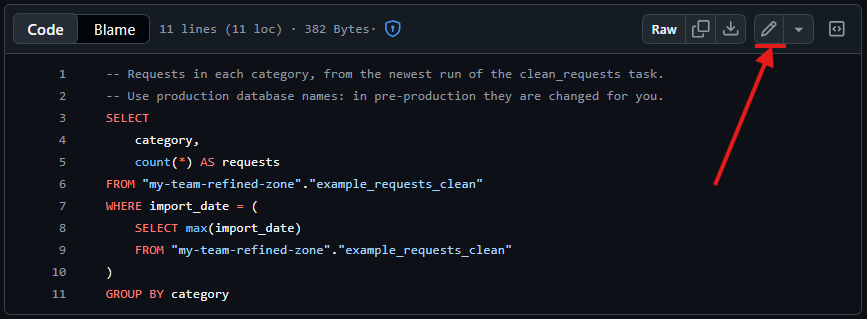
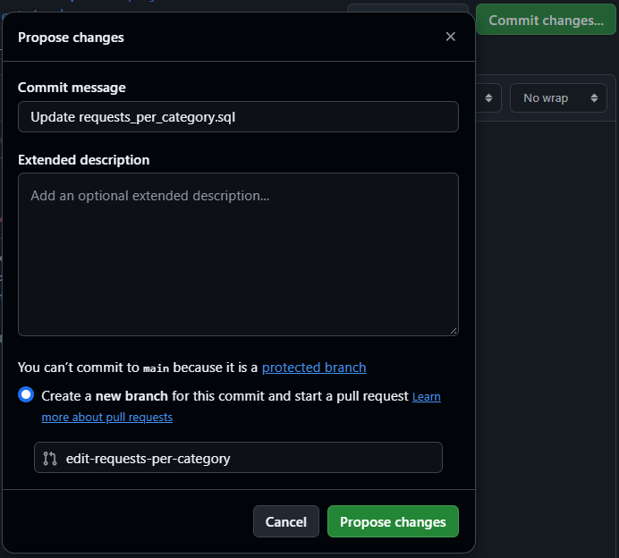
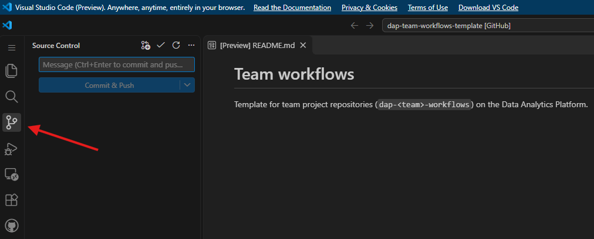
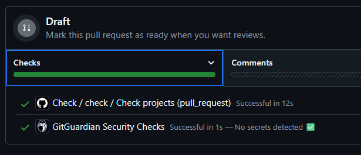
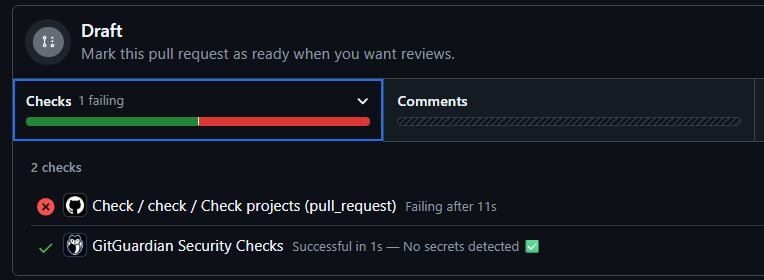

# Make a change

Every change to a project goes through the same three steps in GitHub:

1. Make your edits on a **branch** (a separate copy of the repository — you
   can't edit `main` directly).
2. Open a **pull request** so automated checks and a teammate can check your
   work.
3. **Merge** the pull request into `main` to deploy to pre-production.

You can make changes in the GitHub website or on your own computer. If your
project only has SQL tasks, you can do everything in the GitHub website.

## In the GitHub website

Use the website for small changes to `project.yaml` or a SQL file.

1. Open the file and select the pencil icon (**Edit this file**).

   

2. Make your change.
3. Select **Commit changes**.
4. Choose **Create a new branch for this commit and start a pull request**, give
   the branch a short name, and select **Propose changes**.

   

5. Select **Create pull request**.

### Change several files at once

You have two options in the browser:

- **Using GitHub's normal pages:** select the **main** branch dropdown, create a
  new branch, then edit or add each file while that branch is selected. When you
  finish, select **Compare & pull request**.
- **Using the browser editor:** press `.` on the repository's main page to open
  an editor in the browser. Commit to a new branch from the **Source Control**
  panel, then open the pull request.



:::tip[Not sure how?]
Creating a branch and committing in the browser editor takes a few more steps
than editing one file. If you're not sure how, ask the platform team. They can
take you through it the first time.
:::

## On your computer

Skip this section if your project only has SQL tasks. Work on your computer to
change Python code or its dependencies, and to run the tests. You need Git and
[uv](https://docs.astral.sh/uv/).

The first time, clone the repository:

```sh
git clone https://github.com/LBHackney-IT/dap-<team>-workflows.git
cd dap-<team>-workflows
```

For each new change, start from the latest `main` and create a branch:

```sh
git switch main
git pull
git switch -c my-change
```

Make your change, then run the project's tests:

```sh
cd projects/<project>
uv run pytest
```

To add a Python package, run `uv add <package>` in the project's folder. `uv`
updates `pyproject.toml` and `uv.lock`. Commit both files — **Check** fails if
`uv.lock` doesn't match `pyproject.toml`.

Push the branch and open a pull request:

```sh
git add -A
git commit -m "Describe the change"
git push -u origin my-change
```

GitHub prints a link that opens the pull request.

## Read the checks

The **Check** workflow runs automatically on every pull request. For each
project in `projects/`, it:

1. checks that `project.yaml` is valid, with the same rules Airflow uses;
2. checks that the project is registered with the platform and that its table
   tasks write only to databases registered for it;
3. checks that each file in `sql/` is one `SELECT` query that Athena can read;
4. runs the project's tests (`uv run --frozen pytest`), if it has Python code;
5. builds the project's image, if it has a `Dockerfile`.

A green tick means all of them passed. Select **Details** on a passing check if
you want to preview the DAG name, schedule, and the exact pre-production and
production tables each task will read and write.



If the check fails, select **Details** next to it. Each problem with
`project.yaml` or a SQL file is listed in the run's summary with the project's
name, file and line number.



### Fix a failed check on the same pull request

Don't open a new pull request to fix an error — update the branch your pull
request is already using:

- **In the GitHub website:** open your pull request, go to the **Files changed**
  tab, select **`...`** on the file you need to fix, and select **Edit file**.
  Commit directly to your existing branch.
- **On your computer:** fix the file, commit it, and run `git push` on the same
  branch.

**Check** runs again automatically each time you commit to the branch.

## Review and merge

GitHub asks your team to review the pull request automatically, or you can send
the pull request link to a colleague or team lead.

Merge it once it is approved and the check has passed. The merge starts the
**Deploy** workflow, which puts the change into pre-production.

Next: [Test in pre-production](test-in-pre-production).
