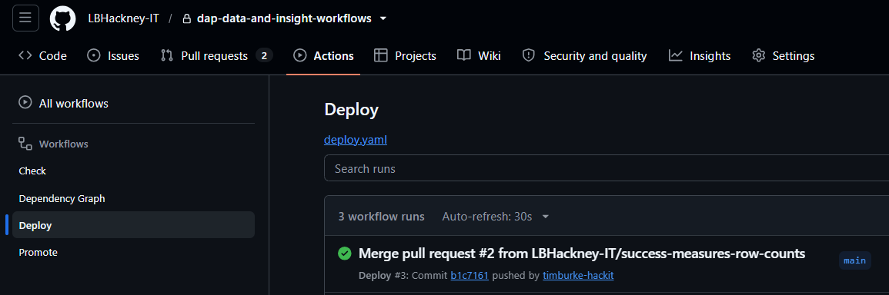
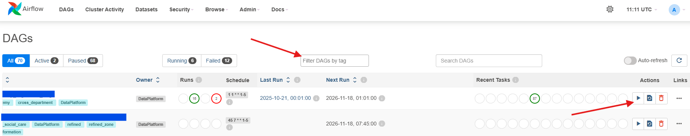
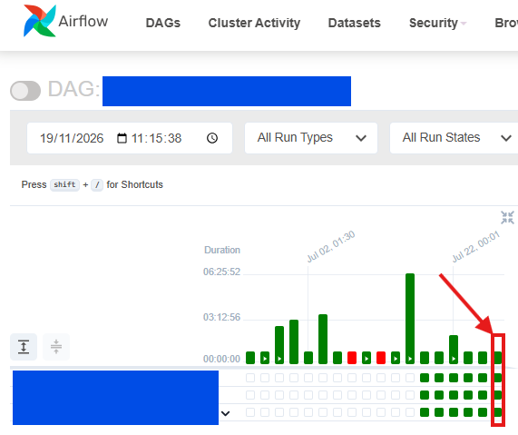
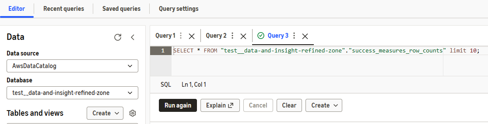

# Test in pre-production

## Wait for the deploy

When a pull request merges, the **Deploy** workflow starts. Find it in the
repository's **Actions** tab. After a few minutes the **Deploy to staging** job
turns green, and the change is in pre-production.



Deploy puts every project in the repository into pre-production, not only the
one you changed. Pre-production always matches `main`.

## Run the DAG

1. Open pre-production Airflow. Ask the platform team for the link if you don't
   have it.
2. Find the DAG named `<team>__<project>`, for example
   `data_and_insight__success_measures_row_counts`.
   You can also type `team_project` or your team in **Filter DAGs by tag**.
3. Select the play button (**Trigger DAG**) in the **Actions** column.

   

4. Select the DAG's name to open it, and wait for every task in the newest run,
   on the right of the grid, to turn dark green.

   

:::info
A new project's DAG can take a few minutes to appear after Deploy finishes.

New DAGs start paused. If the toggle next to the DAG's name is off, switch it on,
or the run waits and doesn't start.
:::

## Find your results

Pre-production reads production data and writes to test databases, so testing
never changes production tables. Write your SQL and code with production
database names. The platform changes the names in pre-production:

| In your SQL or code | In pre-production, if you read it | In pre-production, if you write to it |
| --- | --- | --- |
| `data-and-insight-refined-zone` | `prod__data-and-insight-refined-zone` | `test__data-and-insight-refined-zone` |

- `prod__` databases are links to the production databases. You can read them
  but not change them.
- `test__` databases are pre-production databases that only your projects write
  to.

To look at a table that a test run made, query its `test__` database in
pre-production Athena:

```sql
SELECT * FROM "test__data-and-insight-refined-zone"."success_measures_row_counts" LIMIT 10
```



### How table tasks change names

A table task's SQL is changed only in pre-production, and only the database
names:

| Database in the SQL | In pre-production |
| --- | --- |
| A database that one of the project's table tasks writes to | `test__<database>` |
| Any other database | `prod__<database>` |
| None (a table name on its own) | The task's own database, changed as above |

So a table task that reads a table made earlier in the same project reads the
test copy, not production.

If a database has no `prod__` link, the task fails and names the database. Ask
the platform team to add the link.

### How Python tasks change names

Python code changes the names itself, using the `SOURCE_DATABASE_PREFIX` and
`OUTPUT_DATABASE_PREFIX` environment variables. See
[Python tasks](project-reference#python-tasks).

## If something is wrong

Fix it with another pull request. Production is still running the old version,
and nothing reaches it until you promote the project.

See [When something fails](troubleshooting) for help reading errors.

Next: [Release to production](release-to-production).
