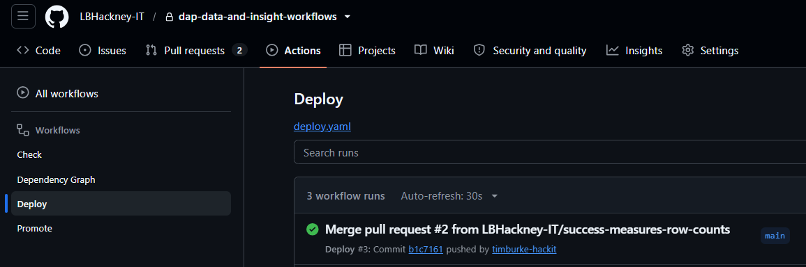
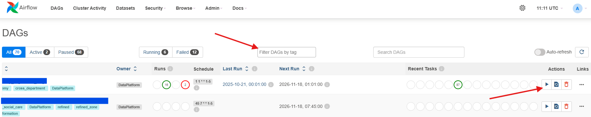
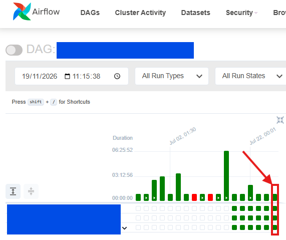
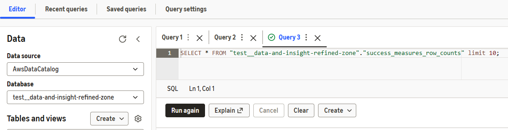

# Test in pre-production

## Wait for the deploy

When a pull request merges, the **Deploy** workflow starts automatically. Find
it in the repository's **Actions** tab. In GitHub Actions, pre-production is
called **staging** — after a few minutes the **Deploy to staging** job turns
green, and the change is in pre-production.



Deploy puts every project in the repository into pre-production, not only the
one you changed. Pre-production always matches `main`.

## Run the DAG

1. Open pre-production Airflow. Ask the platform team for the link if you don't
   have it.
2. Find the DAG named `<team>__<project>`, for example
   `data_and_insight__success_measures_row_counts`. You can also type
   `team_project` or your team name (with underscores) in **Filter DAGs by
   tag**. A new project's DAG can take a few minutes to appear after Deploy
   finishes.
3. **If this is a new project, unpause it first.** New DAGs start paused: if the
   toggle next to the DAG's name is off, switch it on. Without this, a triggered
   run stays queued and doesn't start. (If the DAG has a schedule, switching it
   on may start a scheduled run automatically.)
4. Select the play button (**Trigger DAG**) in the **Actions** column.

   

5. Select the DAG's name to open it, and watch the newest run on the right of
   the grid until every task turns dark green.

   

   Task colours in the grid:
   - **Light green:** running.
   - **Dark green:** succeeded.
   - **Yellow:** failed its first attempt and waiting 10 minutes to retry. You
     can select it and open **Logs** straight away rather than waiting.
   - **Red:** failed after retrying.

## Find your results

Pre-production reads production data and writes to test databases, so testing
never changes production tables. Write your SQL and code with production
database names. The platform changes the names in pre-production:

| In your SQL or code | In pre-production, if you read it | In pre-production, if you write to it |
| --- | --- | --- |
| `data-and-insight-refined-zone` | `prod__data-and-insight-refined-zone` | `test__data-and-insight-refined-zone` |

- `prod__` databases are read-only links to the production databases.
- `test__` databases are pre-production databases that only your projects write
  to.

To look at a table that a test run made, sign in to the **pre-production** AWS
account, open **Athena**, and query its `test__` database:

```sql
SELECT * FROM "test__data-and-insight-refined-zone"."success_measures_row_counts" LIMIT 10
```



### How table tasks change names

A table task's SQL is changed only in pre-production, and only the database
names:

| Database in the SQL | In pre-production |
| --- | --- |
| A database that one of the project's table tasks writes to | `test__<database>` |
| Any other database | `prod__<database>` |
| None (a table name on its own) | The task's own database, changed as above |

So a table task that reads a table made earlier in the same project reads the
test copy, not production.

:::note
Database renaming applies to the whole database, not individual tables. If a
project writes to `data-and-insight-refined-zone`, every reference to
`data-and-insight-refined-zone` in its SQL reads from
`test__data-and-insight-refined-zone` in pre-production — not from
`prod__data-and-insight-refined-zone`. If your query needs an existing
production table from the same database your project writes to, write your
output to another zone (for example `-trusted-zone`) or ask the platform team.
:::

If a database you read has no `prod__` link, the task fails and names the
database. Ask the platform team to add the link.

### How Python tasks change names

Python code changes the names itself, using the `SOURCE_DATABASE_PREFIX` and
`OUTPUT_DATABASE_PREFIX` environment variables. See
[Python tasks](project-reference#python-tasks).

## If something is wrong

Fix it with another pull request. Production is still running the old version,
and nothing reaches it until you promote the project.

See [When something fails](troubleshooting) for help reading errors.

Next: [Release to production](release-to-production).
