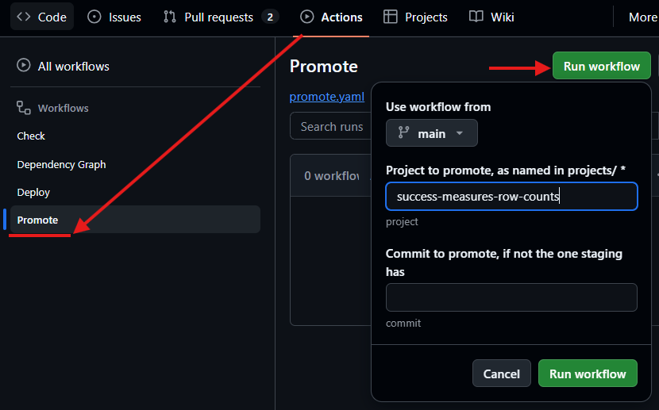
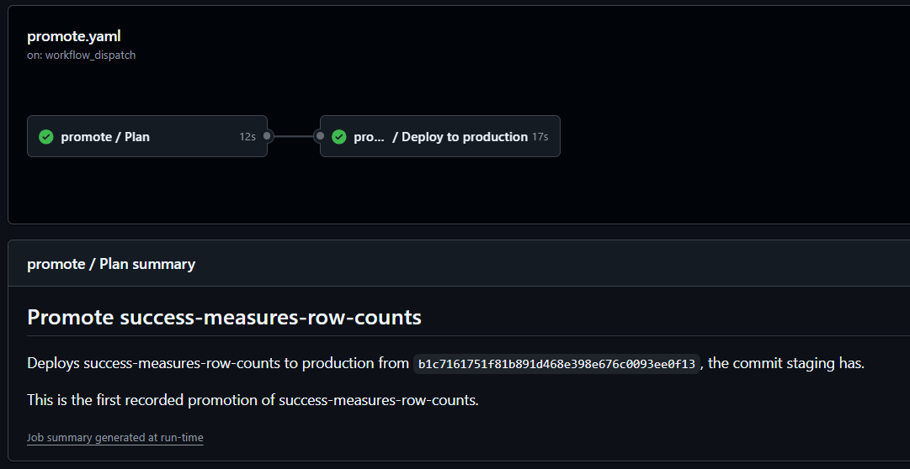
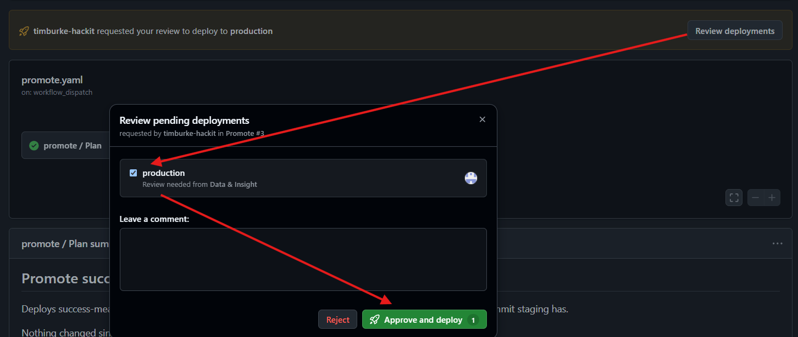
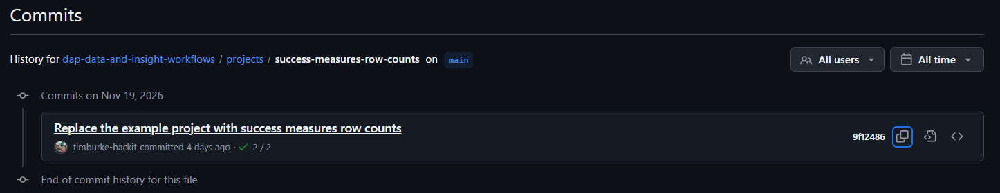
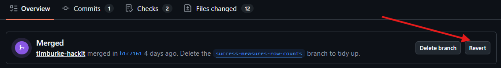

# Release to production

A merge to `main` puts every project into pre-production, but nothing goes to
production until someone promotes it. To release, you run the **Promote**
workflow and choose:

- **the project:** only that project changes in production, and every other
  project stays as it is;
- **the version:** by default, the version of the project that pre-production
  has now. You can choose an earlier one by its commit.

A team lead or the platform team then approves the release.

## Start a promotion

1. Open the repository's **Actions** tab.
2. Select **Promote** in the list of workflows.
3. Select **Run workflow**.
4. Under **Project to promote**, enter the project's folder name from
   `projects/` — with hyphens, for example `success-measures-row-counts` (not
   the Airflow DAG name with underscores).
5. Under **Commit to promote**, leave it empty to release the version that
   pre-production has. To release an earlier version, see
   [Choose a version](#choose-a-version).
6. Select **Run workflow**.

## Check the plan

The **Plan** job works out what will be released, without changing anything.
Open the run and read its summary before asking for approval. It says:

- whether the project will be deployed or removed, and from which commit;
- whether that is the commit pre-production has, or one you chose;
- the changes to the project's folder since its last promotion. If this is the
  project's first promotion, it says so instead.

## Get it approved

The **Deploy to production** job then waits for approval. Send the link to the
**Promote** run to a team lead or the platform team so they know it is ready.

To approve it, they:

1. Open the **Promote** run in the **Actions** tab.
2. Select **Review deployments**.
3. Tick **production** and select **Approve and deploy**.

When the job turns green, the project is in production. The DAG runs on its
schedule, or you can trigger it in production Airflow.

:::info
The first time a project reaches production, its DAG starts paused. Open
production Airflow and switch on the toggle next to its name, or it won't run
on its schedule.
:::

If you start a second promotion of the same project while one is waiting for
approval, the newer one replaces it. Promotions of different projects don't
affect each other.

## Choose a version

Use **Commit to promote** when pre-production has changes to the project that
aren't ready, but an earlier version is. Enter the commit's ID, at least its
first 7 characters. The commit must:

- be on `main`;
- be one that pre-production has had: the version it has now, or an earlier
  one;
- not be older than the version production has.

To find a commit, open the project's folder in GitHub and select **History**.
Each merged pull request shows its commit ID.

To see which version production has, look for the tag
`production/<project>` in the repository's tags. Each promotion moves it.

## Undo a release

Promote never moves a project back to an older version than production has. To
undo a change:

1. Revert it with a pull request, and merge it.
2. Test in pre-production.
3. Promote the project again.

## Remove a project

1. Delete the project's folder with a pull request, and merge it. Deploy removes
   the project from pre-production.
2. Promote the project by its old folder name. The plan says that it will remove
   the project from production.

Tables the project made stay in place. Ask the platform team to remove the
project's AWS setup and any tables you no longer need.
