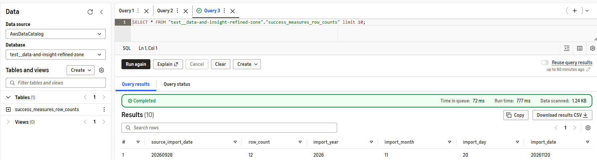

# Project reference

Each folder in `projects/` is one project and one Airflow DAG. The folder name
is the project name:

- Use lowercase letters, numbers and hyphens, starting with a letter.
- Keep it short: `dap-<team>-<project>-workflow` must be 64 characters or fewer
  (for example, up to 34 characters for `data-and-insight`).

```text
projects/example-project/
├── project.yaml          # tasks and schedule
├── sql/
│   └── <table>.sql       # one file for each table task
├── Dockerfile            # only for projects with Python tasks
├── pyproject.toml        # Python dependencies
├── uv.lock
├── src/example_project/  # Python code
└── tests/
```

A project that has only table tasks needs only `project.yaml` and `sql/`.

Deploy copies `project.yaml` and `sql/` to Airflow. If the project has a
`Dockerfile`, Deploy also builds the project's image.

## project.yaml

```yaml
schedule: "0 6 * * 1-5" # 06:00 Monday to Friday, UK time
database: data-and-insight-refined-zone
tasks:
  - id: clean_requests
    module: example_project.clean_requests
  - table: requests_per_category
    history: true
    after: [clean_requests]
```

| Setting | Required | Meaning |
| --- | --- | --- |
| `schedule` | No | When the DAG runs, as a cron expression in UK time. Without it, the DAG runs only when someone triggers it. |
| `database` | For table tasks | The database that table tasks write to, by its production name (must be in the refined or trusted zone, never raw). A task can set its own. |
| `zone` | No | `refined` or `trusted` (see [Zones](../../zones)). Needed only when the database name doesn't end in `-refined-zone` or `-trusted-zone`. A task can set its own. |
| `tags` | No | Extra Airflow tags for the DAG. Use underscores, not hyphens. |
| `tasks` | Yes | The list of tasks. Each one is a table task or a Python task. |

Each task can have `after:`, a list of tasks that must succeed first. Without
`after:`, a task starts when the run starts.

Task IDs and table names must use lowercase letters, numbers and
**underscores** (not hyphens), starting with a letter. A table task's ID is its
`table:` name — don't add `id:` to a table task.

### Common schedules

Schedules use standard 5-field cron syntax in UK time (automatically adjusting
for GMT and BST):

| Schedule | When it runs |
| --- | --- |
| `"0 6 * * *"` | Every day at 06:00 |
| `"0 6 * * 1-5"` | Monday to Friday at 06:00 |
| `"30 7 * * 1"` | Every Monday at 07:30 |
| `"0 6 1 * *"` | First day of each month at 06:00 |
| *(omit `schedule`)* | Only when triggered manually in Airflow |

[crontab.guru](https://crontab.guru/) helps with writing and checking other
expressions.

## Table tasks

A table task runs `sql/<table>.sql` in Athena and saves the result as the table
`<table>` in a refined or trusted zone database (table tasks can't write to
`-raw-zone`).

```yaml
- table: requests_per_category              # runs sql/requests_per_category.sql
  history: true                             # optional
  database: data-and-insight-trusted-zone   # optional, overrides the project's database
```

Write the SQL file as **one `SELECT` query**, the way you would test it in
Athena:

- Leave out `CREATE TABLE`, `INSERT`, and extra statements — the platform
  creates and fills the table for you.
- Use production database names. Pre-production changes them for you.
- Quote database names with double quotes, for example
  `"data-and-insight-refined-zone"."my_table"`. Athena `SELECT` queries don't
  accept backticks.
- Don't return columns called `import_year`, `import_month`, `import_day` or
  `import_date`. Each run adds these.

What each run does:

1. The first run creates the table.
2. Each later run replaces everything in the table with the query's result.
3. Each run adds the columns `import_year`, `import_month`, `import_day` and
   `import_date`, so you can see which run the data came from. The date is the
   day the run covers in UK time (the end of Airflow's run interval — for
   example, a daily job running at 06:00 on 10 November 2026 stamps
   `import_date = '20261110'`, and a manual trigger stamps the day you run it).
4. If the query adds a new simple column (such as a string, number or date), the
   run adds it to the table automatically.
5. If the query removes, renames or changes the type of an existing column, or
   adds a new `array`, `map` or `struct` column, the run fails and says which
   column changed. Ask the platform team to drop or update the table.



### Keeping history

Add `history: true` to keep a copy of every run as well. The run then also saves
its result in `<table>_history`, with one partition for each run's date (don't
name another task `<table>_history`):

- Running a day again replaces that day's copy. It doesn't add a second one.
- `<table>` still holds only the newest data. Running an older day again
  doesn't replace it.
- Rows from before a new column was added have no value in it.

To find an earlier day's data, filter `<table>_history` on `import_date`:

```sql
SELECT *
FROM "data-and-insight-refined-zone"."requests_per_category_history"
WHERE import_date = '20261101'
```

## Python tasks

A Python task runs `python -m <module>` in the project's image, on ECS.

```yaml
- id: clean_requests
  module: example_project.clean_requests   # runs src/example_project/clean_requests.py
```

Airflow passes these environment variables:

| Variable | Production | Pre-production |
| --- | --- | --- |
| `env` | `prod` | `stg` |
| `DATA_INTERVAL_START`, `DATA_INTERVAL_END` | The period the run covers | The period the run covers |
| `SOURCE_DATABASE_PREFIX` | Empty | `prod__` |
| `OUTPUT_DATABASE_PREFIX` | Empty | `test__` |
| `REFINED_ZONE_KMS_KEY`, `TRUSTED_ZONE_KMS_KEY` | Encryption key for the zone | Encryption key for the zone |

Python code adds the prefixes to database names itself. The example project's
`src/example_project/settings.py` shows how, with `source_database()` and
`output_database()`. Remember to set `TEAM` and `PROJECT` in `settings.py` to
your department and project folder name.

A Python task can write files only under `<team>/<project>/` in each zone's
bucket, for example
`s3://dataplatform-stg-refined-zone/data-and-insight/success-measures-row-counts/`.

If a table task reads a table that a Python task writes, write that table to a
database that one of the project's table tasks also writes to. Pre-production
then reads it from the `test__` database.

To add a Python package, run `uv add <package>` in the project's folder. Don't
change the `Dockerfile`.

## What a project can read and write

Each project runs as its own AWS role, `dap-<team>-<project>-workflow`. The
platform team sets the role up from the databases you list when you
[add a project](add-a-project). A project that reads or writes a database
outside that list fails **Check** (for writes) or fails at runtime with an
access error (for reads). Ask the platform team to update the list.
