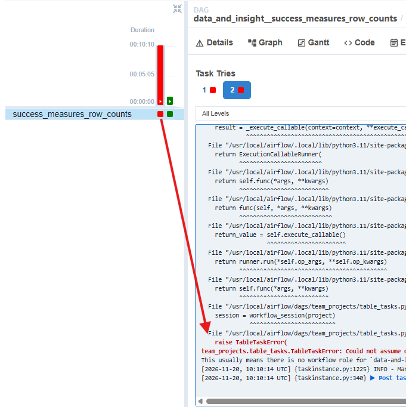
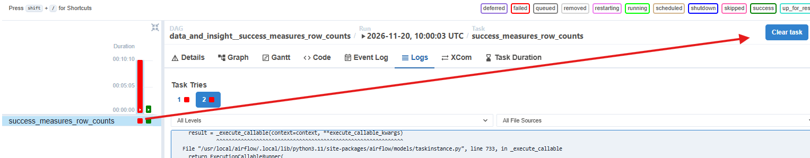

# When something fails

| What failed | What to do |
| --- | --- |
| **Check** on a pull request | Read the error under **Details**, fix it and push again. |
| **Deploy** in the **Actions** tab | Select **Re-run failed jobs**. If it fails again, send the platform team the link to the run. |
| **Promote** in the **Actions** tab | Read the error in the **Plan** job. If it says pre-production is still deploying, wait for **Deploy** to finish and run **Promote** again. Otherwise send the platform team the link to the run. |
| A task in Airflow | Select the red task, then **Logs**. The last lines say what went wrong. Fix it with a pull request, then trigger the DAG again. |
| A task says "Ask the platform team to set up" | The project's AWS setup is missing. Send the message to the platform team. |
| A table task says a column was removed, renamed or changed type | The table can't change in that way by itself. Ask the platform team. |
| A table task says a database has no `prod__` link | Pre-production can't read that database yet. Ask the platform team to add the link. |
| The task `fix_project_yaml` fails | `project.yaml` is broken. The check should have caught it, so send the error to the platform team. |

## Read a task's logs

1. In Airflow, open the DAG and select the **Grid** view.
2. Select the red square for the failed task.
3. Select **Logs**.

A table task's log includes the Athena query ID. Search for it in Athena's
**Recent queries** to see the exact SQL that ran.

## Rerun a day

Select that day's run in Airflow, select the task, then **Clear**. A table task
replaces that day's data rather than adding to it.

## Failure alerts

Production failures alert the platform team, who will contact you. Alerts to
each team's own channel are planned.
