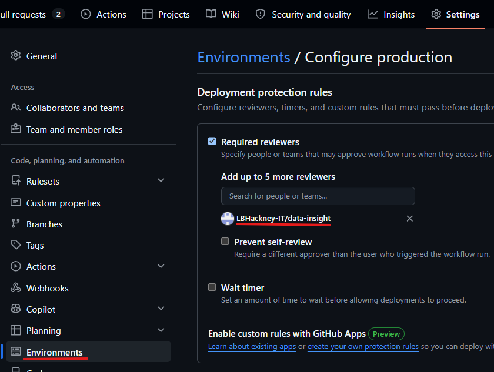

# Add a project

## Create the folder

1. Copy `projects/example-project` from
   [dap-team-workflows-template](https://github.com/LBHackney-IT/dap-team-workflows-template)
   into your repository's `projects/` folder.
2. Rename the folder. Use lowercase letters, numbers and hyphens.
3. Change `project.yaml`, the SQL and the code for your project.
4. If the project has only table (SQL) tasks, delete `Dockerfile`, `pyproject.toml`,
   `uv.lock`, `src/` and `tests/`. These are only needed for Python tasks.

## Ask the platform team

Before the first merge, ask the platform team to set the project up. Copy this
into your request and fill it in:

```text
Team: <your department, for example data-and-insight>
Project: <folder name, for example success-measures-row-counts>
Repository: <link to your repository>

Reads: <databases or tables the project reads>
Writes: <databases the project writes to, by production name>
Secrets: <Secrets Manager names the Python code reads, or "none">
Python tasks: <yes or no>
CPU and memory: <only if a Python task needs more than the default>
```

Requests can be sent via Halo to the Data Analytics Platform team. 

A project merged before this is done fails its first task with "Ask the platform
team to set up `<team>/<project>`". Nothing else is affected.

Ask again if the project starts to read or write different databases. Changes to
code, SQL, tasks or the schedule don't need the platform team.

## For the platform team

### Set up a project

1. Add the project to `workflows.yaml` in dap-infrastructure. This creates the
   project's role, `dap-<team>-<project>-workflow`, in both accounts, with read
   access from `reads` and write access to the `writes` databases. In
   pre-production it also creates the `test__` databases and grants read on the
   `prod__` links. The module's README describes each setting.
2. For a project with Python tasks, add a dap-ecs service named
   `<team>-<project>`, with `ecr_repository = true` and a container named
   `project`.

```yaml
workflows:
  data-and-insight/success-measures-row-counts:
    reads:
      department: [data-and-insight]
      zone: [raw, refined, trusted]
    writes:
      - data-and-insight-raw-zone
      - data-and-insight-refined-zone
```

### Set up a team repository

Once for each team:

1. Create the repository from `dap-team-workflows-template`, named
   `dap-<team>-workflows`, where `<team>` is the platform department. Deploy and
   Promote read the team from the name.
2. Create the GitHub environments `staging` and `production`. Give each one the
   secrets `ACCOUNT`, `OIDC_URL` and `MWAA_BUCKET` for the pre-production and
   production accounts.
3. Add the team's leads and the platform team as required reviewers on
   `production`. You will need to add grant the teams access to the repository before you do this.
4. Protect `main` so that changes arrive through pull requests that pass
   **Check**.
5. In `.github/CODEOWNERS`, uncomment the `/projects/` line and give it the
   team's GitHub team. Give the team write access to the repository. The
   platform team still approves changes to `.github/`.



Creating the repository runs **Deploy** on the template's commit. That run fails
because the environments don't exist yet, and it changes nothing.

Rename or delete `projects/example-project` in the team's first pull request.
Deploy deploys every folder in `projects/`, so the example would otherwise
deploy too, and fail to push its image.

### Shared workflows

The team repository calls the **Check**, **Deploy** and **Promote** workflows in
[dap-ci-cd-workflows](https://github.com/LBHackney-IT/dap-ci-cd-workflows). Its README describes how they work and how to release a change to them.
