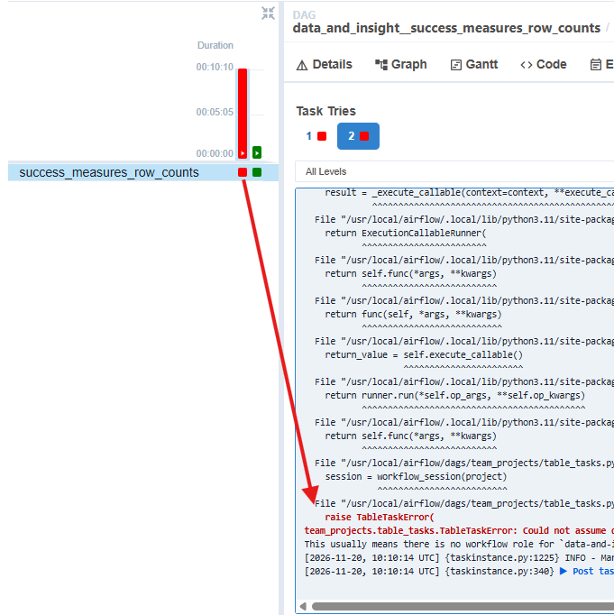
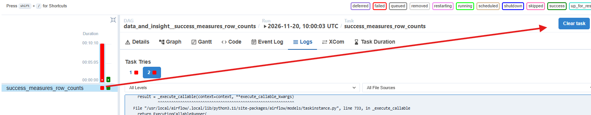

# When something fails

| What happened | What to do |
| --- | --- |
| **Check** fails on a pull request | Select **Details** to read the error, fix it on the same branch (see [Fix a failed check](make-a-change#fix-a-failed-check-on-the-same-pull-request)), and commit again. |
| **Check** says the project isn't registered, or writes to a database it isn't allowed to | Ask the platform team via Halo to register the project or add the database (see [Add a project](add-a-project#1-ask-the-platform-team-to-register-the-project)). Once they confirm, re-run **Check**. |
| **Deploy** fails in the **Actions** tab | Select **Re-run failed jobs**. If it fails again, send the platform team the link to the run. |
| **Promote** fails in the **Actions** tab | Read the error in the **Plan** job. If it says staging's last deploy didn't finish, run **Deploy** again, then run **Promote** again. Otherwise send the platform team the link to the run. |
| Triggered DAG stays queued and doesn't start | The DAG is paused. Switch on the toggle next to the DAG's name in Airflow. |
| A task in Airflow is **yellow** | It failed its first attempt and is waiting 10 minutes to retry. Select the yellow square and open **Logs** straight away to see the error. |
| A task in Airflow is **red** | Select the red task, then **Logs**. The last lines say what went wrong. Fix it with a pull request, then trigger the DAG again. |
| A task says "Ask the platform team to set up" | The project's AWS setup (role or ECS service) is missing. Send the message to the platform team. |
| A table task says a column was removed, renamed or changed type | The table can't change in that way by itself. Ask the platform team to drop or update the table. |
| A table task says a database has no `prod__` link | Pre-production can't read that database yet. Ask the platform team to add the link. |
| A table task in pre-production can't find an existing production table | If the table is in the same database the project writes to, pre-production looks in `test__<database>` instead of `prod__<database>`. Write your project's output to another zone, or ask the platform team. |
| The task `fix_project_yaml` fails | `project.yaml` is broken. **Check** should have caught it, so send the error to the platform team. |

## Read a task's logs

1. In Airflow, open the DAG and select the **Grid** view.
2. Select the red (or yellow) square for the failed task.
3. Select **Logs**.

A table task's log includes the Athena query ID. Search for it in Athena's
**Recent queries** to see the exact SQL that ran.

## Rerun a day

Select that day's run in Airflow, select the task, then **Clear**.

- For a table task **without** `history: true`, rerunning replaces the whole
  table with the current query result (stamped with that run's date).
- For a table task **with** `history: true`, rerunning replaces only that day's
  partition in `<table>_history` rather than adding a second copy, and leaves
  `<table>` holding the newest date.

## Failure alerts

Production failures alert the platform team, who will contact you. Alerts to
each team's own channel are planned.
