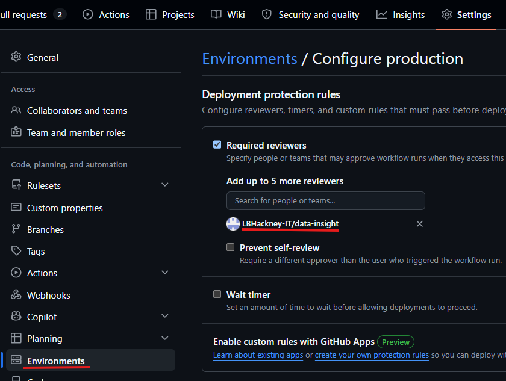

# Platform team setup

This page is for the Data Analytics Platform team. Analysts adding a project
should start at [Add a project](add-a-project).

## Set up a project

1. Add the project to `accounts/production/workflow-roles/workflows.yaml` in
   `dap-infrastructure`. This creates the project's role,
   `dap-<team>-<project>-workflow` (maximum 64 characters), in both accounts,
   with read access from `reads` and write access to the `writes` databases. In
   pre-production it also creates the `test__` databases and grants read on the
   `prod__` links. The `workflow-role` module's README describes each setting.
2. For a project with Python tasks, add a `dap-ecs` service named
   `<team>-<project>`, with `ecr_repository = true` and a container named
   `project`.

If the project only reads its own department's databases, omit `reads:` — it
defaults to the team's department:

```yaml
workflows:
  data-and-insight/success-measures-row-counts:
    writes:
      - data-and-insight-refined-zone
```

To restrict or widen reads explicitly, set `reads:` using Lake Formation tag
values. Note that `department` tag values use **underscores**, not hyphens:

```yaml
workflows:
  data-and-insight/success-measures-row-counts:
    reads:
      department: [data_and_insight]
      zone: [raw, refined, trusted]
    writes:
      - data-and-insight-raw-zone
      - data-and-insight-refined-zone
```

Once merged to `main` in `dap-infrastructure`, **Check** in the team's
repository picks up the new entry straight away.

## Set up a team repository

Once for each team:

1. Create the repository from `dap-team-workflows-template`, named
   `dap-<team>-workflows`, where `<team>` is the platform department. Deploy and
   Promote read the team from the name.
2. Create the GitHub environments `staging` and `production`. Give each one the
   secrets `ACCOUNT` and `MWAA_BUCKET` for the pre-production and production
   accounts.
3. Give the team write access to the repository, then add the team's leads and
   the platform team as required reviewers on `production`. (The teams must have
   access to the repository before they can be added as reviewers.)
4. Protect `main` so that changes arrive through pull requests that pass
   **Check**.
5. In `.github/CODEOWNERS`, uncomment the `/projects/` line and give it the
   team's GitHub team. The platform team still approves changes to `.github/`.



Creating the repository runs **Deploy** on the template's commit. That run fails
because the environments don't exist yet, and it changes nothing.

Rename or delete `projects/example-project` in the team's first pull request.
**Check** will fail on `example-project` because `<team>/example-project` isn't
registered in `workflows.yaml`, and **Deploy** would otherwise try to deploy it
and fail to push its image.

## Shared workflows

The team repository calls the **Check**, **Deploy** and **Promote** workflows in
[dap-ci-cd-workflows](https://github.com/LBHackney-IT/dap-ci-cd-workflows). Its
README describes how they work and how to release a change to them.
